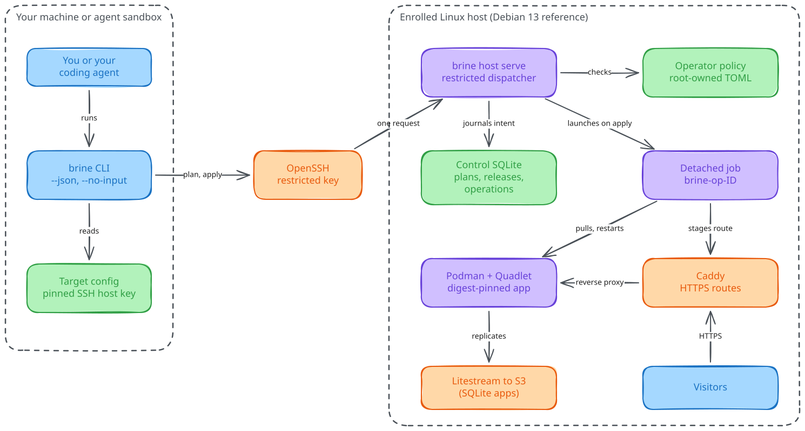

<h1 align="center">Brine</h1>
<p align="center">Deploy containerized apps to a Linux server you own. Review a plan, apply it by ID, and let a coding agent drive the same commands through JSON.</p>
<p align="center"><a href="https://github.com/ShaulLavo/brine/actions/workflows/ci.yml"></a></p>

```text
$ ./brine validate examples/offline/brine.toml --policy examples/offline/policy.toml
Valid app hello
Image: ghcr.io/team/hello@sha256:aaaaaaaaaaaaaaaaaaaaaaaaaaaaaaaaaaaaaaaaaaaaaaaaaaaaaaaaaaaaaaaa
Domains: hello.example.com
Container port: 3000
Policy: operator-1
Environment: 1 keys (values hidden), secrets: 0 references

$ ./brine plan examples/offline/brine.toml --offline --snapshot examples/offline/fresh-host.json --policy examples/offline/policy.toml
OFFLINE PLAN — NOT APPLYABLE
create  hello
+ image: sha256:aaaaaaaaaaaa... (linux/arm64, manifest unknown)
+ domain: hello.example.com
+ host port: 20000
+ resources: 512 MiB, 128 PIDs
~ render app service
~ routing generation: 0 -> 1
~ restart app
```

Brine is pre-1.0 and experimental. Output above is trimmed from a real run.

## Why Brine

- **Plan, then apply.** `brine plan` saves a plan on the server. `brine apply PLAN_ID` runs that plan after checking it is still fresh and still allowed by the operator policy.
- **Safe to retry.** You choose an idempotency key before `apply`. If the connection drops, the same key finds the same operation instead of starting a second one. Accepted does not mean finished: you poll `brine status --operation ID`.
- **Narrow credentials.** The deploy key can run one forced command, `brine host serve`. It gets no shell, no Podman socket and no root. The operator policy decides which images, domains and secrets it can use.
- **Built for agents.** `--json` prints exactly one envelope on stdout. `--no-input` forbids prompts. Exit codes separate usage errors (2), policy refusals (4), stale plans (5) and "recover first" (6).
- **Existing tools underneath.** Caddy for HTTPS, rootless Podman with Quadlet and systemd for containers, SQLite for control state, and Litestream for app databases.

<picture>
  <source media="(prefers-color-scheme: dark)" srcset="docs/assets/architecture.dark.svg">
  
</picture>

*Everything that changes the server goes through `brine host serve`. The detached job keeps running if your SSH session drops.*

## Quick start

You need Go 1.26 or newer and `ssh`. These steps run on your laptop and touch no server.

```sh
git clone https://github.com/ShaulLavo/brine
cd brine
go build -o brine ./cmd/brine
./brine doctor
./brine validate examples/offline/brine.toml --policy examples/offline/policy.toml
./brine plan examples/offline/brine.toml --offline --snapshot examples/offline/fresh-host.json --policy examples/offline/policy.toml
```

`doctor` prints `ssh` and `git` versions. The last command prints the `create` plan shown above, plus a plan hash. Offline plans are previews and cannot be applied.

There are no release binaries yet, so building from source is the only install path. Continue with [Getting started](docs/getting-started.md) to read a plan, see a conflict plan and use the JSON mode.

## What you can do

| Task | Where |
| --- | --- |
| Preview a deploy without a server | [Getting started](docs/getting-started.md) |
| Enroll a server, then plan, apply, roll back and remove an app | [Deploy an app](docs/guides/deploy-an-app.md) |
| Give an app a SQLite database with backups | [Using a database](docs/using-a-database.md) |
| Run a managed SpacetimeDB app | [SpacetimeDB runbook](docs/runbooks/spacetimedb.md) |
| Fix a failed or stuck operation | [Troubleshooting](docs/troubleshooting.md) |
| Look up a command, flag or config key | [Commands](docs/reference/commands.md), [Configuration](docs/reference/configuration.md) |

## How it works

The `brine` binary runs on your machine and also on the server. On the server, `brine host serve` reads one bounded JSON request per SSH connection, checks it against an allowlist and the root-owned operator policy, and writes one JSON response. Planning changes nothing on the server except saving the plan under its hash. `apply` journals the operation, then starts a transient systemd user unit that does the work, so a dropped connection leaves a durable record instead of a half-run script. [Architecture](docs/ARCHITECTURE.md) walks through the layers, and [DECISIONS](docs/DECISIONS.md) records why they look this way.

## Docs

[Getting started](docs/getting-started.md) · [Guides](docs/README.md#guides) · [Concepts](docs/ARCHITECTURE.md) · [Reference](docs/README.md#reference) · [Decisions](docs/DECISIONS.md) · [All docs](docs/README.md)

## Status

Pre-1.0, experimental, single maintainer. There is no release, tag or license yet. Details are in [Status and limits](docs/status.md).

- **Works today:** enrollment, connected and offline planning, detached deploy, status, logs, diagnosis, reconcile, rollback, config and secret changes, start/stop/restart, stateless removal, SQLite databases with Litestream backups and restore checks.
- **Implemented, acceptance incomplete:** managed SpacetimeDB commands and the remaining SQLite backup drills.
- **Not built:** the full Charm interface (`brine tui` shows a welcome screen), static drops, git previews, UDP and WebTransport publishing, migrations for existing databases.
- **Platforms:** the server must be Debian 13 on amd64 or arm64. The client builds and runs on macOS arm64 and Linux. Windows is untested.
- **Evidence:** one physical Raspberry Pi (arm64) has run the deploy, rollback, recovery and reboot drills. That is not a production-readiness or zero-downtime claim.

## License, contributing, security

No license has been chosen, so no one has permission to reuse the code yet. See [CONTRIBUTING.md](CONTRIBUTING.md) for setup and checks, [AGENTS.md](AGENTS.md) for coding agents, and [SECURITY.md](SECURITY.md) to report a vulnerability.
