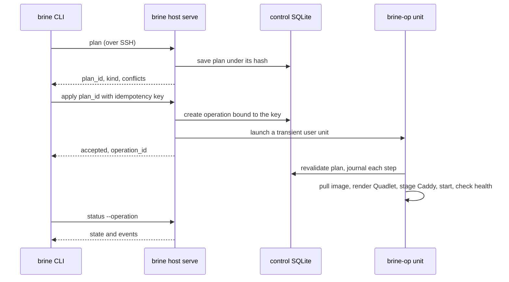

# Architecture

Brine is a small deployment system for one Linux server, driven by a person or a coding agent. It borrows the hard parts from software that already works (Caddy, Podman, systemd, SQLite, Litestream) and adds the part those tools lack: a reviewed plan, a recorded operation, and a credential that can do nothing else.

This page explains why the pieces are arranged as they are. For commands, see the [command reference](reference/commands.md). For the reasons behind each choice, see [DECISIONS](DECISIONS.md).

<picture>
  <source media="(prefers-color-scheme: dark)" srcset="assets/architecture.dark.svg">
  
</picture>

*The dashed box on the right is the only place Brine changes anything. The client never runs Podman, systemd or Caddy itself.*

## The client is thin and the server keeps the state

The same `brine` binary runs on your machine and on the server. On the server it runs as an unprivileged runner user with rootless Podman and systemd user services. All durable state lives there: plans, releases, operations and events sit in a control SQLite database, separate from any app database. A person on a laptop and an agent in a sandbox therefore see the same plan IDs and the same operations ([D1](DECISIONS.md#d1-brine-runs-on-the-host-the-laptop-is-a-client)).

The client holds only the target: an SSH destination and a pinned host key. It reaches the server through the system OpenSSH binary with typed arguments, so your `~/.ssh/config`, SSH agent and Tailscale addressing keep working. Brine never builds a shell string.

## One forced command is the whole API

Enrollment installs a deploy key whose `authorized_keys` entry forces `brine host serve`. That command ignores whatever the client asked to run. It reads one bounded JSON request, checks the operation against an allowlist and the root-owned operator policy, and writes one JSON response. The key cannot open a shell, forward a port or reach Podman, systemd or Caddy directly.

This is the idea the rest depends on. An agent holding the deploy key can plan and apply what the operator allowed, and nothing else. Root-owned files and an SSH drop-in make the restriction hard to remove from the runner account ([D7](DECISIONS.md#d7-the-runner-cant-replace-its-own-ssh-restriction)).

## Apply is a recorded operation, not a script

Read it from the top. `plan` saves a plan and returns an ID. `apply` creates the operation first, then starts a transient systemd user unit that does the work, and answers `accepted` before any of it finishes. A dropped SSH session cannot stop the job, and the same idempotency key always finds the same operation. The unit's state is not authoritative, because transient units do not survive a reboot. The control database is, and a boot-time reconcile unit settles any operation it shows as unfinished.

An operation ends in `succeeded`, `failed`, `rolled_back` or `recovery_required`. The last one means Brine could not prove the host state. It refuses to guess, and the recovery commands (`diagnose`, `reconcile`, `resolve`) are separate steps a person or agent chooses.

## Caddy config is generated whole and validated first

Brine owns one directory of Caddy files, one per app, rendered from typed fields only: the site address, a `reverse_proxy` to the app's loopback port, and fixed headers. Each change renders a complete new generation, validates it with `caddy validate`, repoints a symlink and reloads. A failed reload points back at the previous generation ([D4](DECISIONS.md#d4-caddy-a-brine-owned-config-set-validated-whole-reloaded-through-systemd)). The trade-off is that a compromised runner can reroute any domain on the host, so the dispatcher and policy are the boundary, not file ownership.

## Data is separate from releases

An app image and an app database have different identities and different authority. Rolling an app back never rewinds its data. SQLite databases are declared in `brine.toml`, live under policy-approved roots, and replicate asynchronously through Litestream to S3-compatible storage. A restore test restores into an isolated directory and checks the result, and it never touches the live file. Managed SpacetimeDB follows the same rule with its own commands, fenced operations and encrypted native backups ([D11](DECISIONS.md#d11-persistent-sqlite-uses-a-mapped-app-user-and-a-host-litestream-unit), [D13](DECISIONS.md#d13-spacetimedb-is-a-managed-data-engine-alongside-sqlite)). See [Reviewed first-database initialization](data-initialization.md).

## Guardrails

- **Plan before apply.** A conflict plan is a successful result and never permission to apply. An unprivileged agent cannot set a flag that implies approval.
- **No default root access.** Routine operations never get a root shell. Destructive host operations need separate credentials and operator policy.
- **Machine-readable by default.** JSON on stdout, diagnostics on stderr, stable exit categories, operation IDs, and no prompts under `--no-input`.
- **Acceptance is not completion.** Save the idempotency key before a mutation, then poll the operation ID.
- **Target context stays explicit.** Follow-up commands keep the same `--target` and `--config-dir`.
- **Honest availability.** Zero downtime is not claimed. Brief downtime during a deploy is accepted.

## Trust model and non-goals

Brine is a personal deployment service. It deploys code written by the owner and the owner's agents, with the owner's scoped credentials. Visitors to a deployed site are untrusted, but no stranger uploads code. Isolation is designed to protect the host from mistakes and compromised dependencies, to keep agents inside policy, and to keep apps from reading each other's secrets. Hostile-uploader hardening is not a goal.

Non-goals: multi-server orchestration, a custom container engine, Kubernetes, a web dashboard, and creating or deleting cloud machines. See [Status and limits](status.md).
