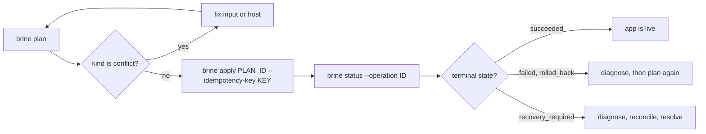

# How to deploy an app to a server

Enroll a Debian 13 server, allow your image and domain, then plan, apply and check a deployment.

This guide changes a real server. Enrollment installs packages and an SSH restriction, so read the change list before you confirm it. The commands below follow the code and [CONTRACTS](../CONTRACTS.md). They were not run against a live server when this page was written, so treat the JSON field paths as the first thing to check if a command surprises you.

You need:

- A Debian 13 server (amd64 or arm64) that you can reach by SSH as root, or as a user with non-interactive sudo.
- A digest-pinned image in a registry that needs no login. Brine reads only anonymous registry tokens.
- A DNS name for the app that points at the server.
- A built `brine` binary, `ssh-keygen`, `jq` and `openssl`. See [Getting started](../getting-started.md#build-the-cli).



*Every change follows this loop. A `conflict` plan loops back to planning, and `recovery_required` leaves the loop for the recovery commands.*

## Enroll the server

1. Create a deploy key. Brine accepts only Ed25519 keys.

   ```sh
   ssh-keygen -t ed25519 -f "$HOME/.ssh/brine-deploy"
   ```

2. If your client is not Linux on the server's architecture, build a matching server binary. For an arm64 server:

   ```sh
   CGO_ENABLED=0 GOOS=linux GOARCH=arm64 go build -o brine-linux-arm64 ./cmd/brine
   ```

3. Enroll. Use your own admin destination and pick a target name. Add `--host-binary ./brine-linux-arm64` when step 2 applies.

   ```sh
   ./brine enroll root@server.example.com --target-name mybox \
     --deploy-key "$HOME/.ssh/brine-deploy.pub"
   ```

   Brine runs a read-only inventory, prints the complete list of changes, and waits. Type the target name to confirm. Enrollment refuses `--json`, `--no-input` and a non-terminal stdin, and `--yes` does not skip the confirmation.

The client saves the target under `brine/targets` inside your user config directory. Pass `--config-dir` to every later command if you chose another directory. To remove the enrollment later, run the same `enroll` command with `--undo`.

## Allow your registry and domain

A new enrollment installs a policy that denies every registry, domain and secret. Use the admin connection to allow yours:

```sh
./brine permissions plan --target mybox --admin root@server.example.com \
  --allow-registry ghcr.io/team --allow-domain hello.example.com --json \
  | jq -r .data.plan.id
```

Review the plan, then apply it with a key you generate and keep:

```sh
KEY=$(openssl rand -hex 16)
./brine permissions apply --target mybox --admin root@server.example.com \
  --plan-id PLAN_ID --idempotency-key "$KEY"
```

If the connection drops, run `permissions status` with the same key. Never invent a second key for the same change. This command edits registries and domains only. To allow a secret, edit `/etc/ssh/brine/operator-policy.toml` on the server as root. See the [configuration reference](../reference/configuration.md#operator-policy).

## Plan and apply a deployment

1. Write `brine.toml` for your app. The [configuration reference](../reference/configuration.md#app-definition-brinetoml) lists every key.

2. Plan against the server, and read the result:

   ```sh
   ./brine plan brine.toml --target mybox --json | jq '{plan_id: .data.plan_id, kind: .data.kind, conflicts: .data.conflicts}'
   ```

   If `kind` is `conflict`, do not apply. Fix the input or the host condition and plan again. If the app fails policy, the command exits 4.

3. Save an idempotency key before you apply. Any token of letters, digits, `_` and `-` up to 128 characters works.

   ```sh
   KEY=$(openssl rand -hex 16); echo "$KEY"
   ./brine apply PLAN_ID --target mybox --idempotency-key "$KEY" --json
   ```

   The response says `accepted` and carries an `operation_id`. Accepted does not mean deployed.

4. Poll the operation until its state is terminal:

   ```sh
   ./brine status --operation OPERATION_ID --target mybox --json | jq -r .data.operation.state
   ```

   `succeeded` ends the loop. `failed` and `rolled_back` mean the app did not change as planned. `recovery_required` means Brine stopped rather than guess. Pass `--after-cursor N` with the returned `next_cursor` to read only new events.

5. Check the app and its logs:

   ```sh
   ./brine status hello --target mybox
   ./brine logs hello --target mybox --tail 50
   ```

If `apply` loses its response, rerun it with the same `--idempotency-key`. The key finds the same operation. A fresh key starts a second one.

## Change configuration or secrets

Configuration changes are plans too. Set an environment variable, then apply the plan it returns:

```sh
./brine config set hello APP_ENV=production --target mybox --json | jq -r .data.plan_id
```

Store a secret value from stdin. It never goes in an argument. Then bind it to an environment variable through `config set`:

```sh
printf '%s' "$VALUE" | ./brine secret set hello hello-token --target mybox
./brine config set hello secrets.API_TOKEN=hello-token --target mybox --json | jq -r .data.plan_id
```

`secret set` only stores an unbound version. The reference must appear in the operator policy's `allowed_secrets` for `hello`, and the plan binds it. Rotation creates a new version and a new plan.

## Roll back, stop or remove

Each of these returns a plan. Apply it the same way as a deployment.

```sh
./brine rollback hello --target mybox          # previous known-good release
./brine stop hello --target mybox
./brine start hello --target mybox
./brine remove hello --target mybox
```

Rollback changes the app image and configuration only. It never rewinds a database. `remove` refuses an app with persistent data and returns `persistent_archive_required`.

## Recover from an uncertain outcome

After a timeout, a dropped SSH session or a `recovery_required` state, inspect before you retry:

```sh
./brine diagnose hello --target mybox
./brine reconcile --target mybox --dry-run
```

`diagnose` and `reconcile --dry-run` are read-only. When you are satisfied, run `reconcile` without `--dry-run`, or `brine resolve OPERATION_ID --target mybox` for a terminal `recovery_required` operation. Do not repeat the original mutation with a new key. See [Troubleshooting](../troubleshooting.md).
