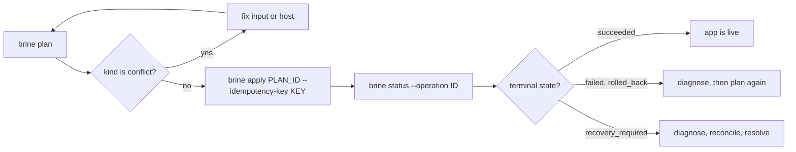

# How to deploy an app to a server

Enroll a Debian 13 server, allow your image and domain, then plan, apply and check a deployment.

This guide changes a real server. Enrollment installs packages and an SSH restriction, so read the change list before you confirm it. The commands below follow the code and [CONTRACTS](../CONTRACTS.md). They were not run against a live server when this page was written, so treat the JSON field paths as the first thing to check if a command surprises you.

You need:

- A Debian 13 server (amd64 or arm64), because enrollment requires systemd 257, cgroup v2 and Debian's Podman 5.4 packages. You must be able to reach it you can reach by SSH as root, or as a user with non-interactive sudo.
- A digest-pinned image in a registry that needs no login. Brine reads only anonymous registry tokens.
- A DNS name for the app that points at the server.
- A built `brine` binary. See [Getting started](../getting-started.md#build-the-cli).
- `ssh` and `scp` on your machine, because enrollment connects and copies the binary with them. `ssh-keygen` makes the deploy key, `openssl` makes idempotency keys, and `jq` reads the JSON output.
- A server whose SSH host key your machine already trusts. Enrollment connects with `StrictHostKeyChecking=yes`, so run `ssh root@server.example.com true` once first and accept the key.
- Outbound HTTPS from the server. Enrollment downloads pinned Litestream and restic releases on the server and installs missing Debian packages.



*Every change follows this loop. A `conflict` plan loops back to planning, and `recovery_required` leaves the loop for the recovery commands.*

## What enrollment changes on the server

`brine enroll` is the only command that sets a server up. You run it once per server, over your own admin SSH access. It does the following, in this order of concern:

- **Packages.** Installs whichever of `podman`, `passt`, `caddy`, `uidmap`, `fuse-overlayfs`, `dbus-user-session` and `polkitd` are missing. It never upgrades or removes a package. Caddy is masked before the install and started only after Brine's config is in place, so its default site is never exposed. Podman's `netavark` dependency can enable its DHCP proxy and firewalld-reload units as a package side effect.
- **A runner account.** Creates a user named `brine` with lingering enabled, a root-owned home and a runner-owned state directory. It refuses an existing `brine` account it did not create.
- **The `brine` binary.** Installs it at `/usr/local/bin/brine`. See [Where the server gets its binary](#where-the-server-gets-its-binary).
- **SSH restriction.** Adds `/etc/ssh/sshd_config.d/00-brine-brine.conf`, which forces every `brine` login into `brine host serve`, and reloads `ssh.service`. Installs your public deploy key under `/etc/ssh/brine/authorized_keys/brine`, plus a requester identity and an inventory key in `/etc/ssh/brine`.
- **Operator policy.** Installs `/etc/ssh/brine/operator-policy.toml` only if the file does not exist. The default denies every registry, domain and secret.
- **Caddy.** Creates `/etc/caddy/brine/gen-0`, adds one line to the main Caddyfile (`import /etc/caddy/brine/current/*.caddy`), installs a polkit rule that lets the runner reload `caddy.service` and nothing else, then enables and starts Caddy.
- **Tools.** Installs Litestream 0.5.17 under `/opt/brine/litestream` and a pinned restic release under `/opt/brine`, each checked against a SHA-256 before it is installed. Writes `/etc/brine/runner-storage.conf` for rootless Podman storage, plus a boot-time reconcile unit.
- **A journal.** Records what it created in a root-owned journal, so `--undo` removes only what enrollment made.

It makes no firewall, DNS, Tailscale or other-user changes. It refuses to continue if the server is not Debian 13 on amd64 or arm64 with systemd 257, if something other than Caddy listens on port 80 or 443, or if sshd allows `PermitUserEnvironment` or loader-style `AcceptEnv` and `SetEnv` values.

### What it prints before you confirm

Before it changes anything, enrollment connects over admin SSH, runs a read-only inventory, then prints:

1. A numbered list of every change above, with exact paths, modes and, for Litestream and restic, the download URL and checksums.
2. One `Package transaction: install NAME=VERSION` line for each package it would install.
3. The prompt `Type target name "mybox" to confirm:`.

Nothing in the list is applied until you type the target name exactly. To get the inventory and the list, the client first uploads its binary to a private `/tmp/brine-enroll.XXXXXXXX` directory on the server and runs it there. Enrollment removes that directory afterward, even if you decline.

### Where the server gets its binary

The server never downloads `brine`. There are no release binaries yet. Enrollment copies the binary that is running on your machine to the server with `scp`, and later keeps it at `/usr/local/bin/brine`. That copy is what the forced command runs on every deploy, so the server only works if the binary matches it.

- The binary must be a Linux ELF for the server's architecture. Enrollment reads `uname -m` over SSH and checks the ELF header, and refuses with `host binary architecture mismatch` or `a matching Linux ELF binary is required` otherwise.
- On a Linux laptop of the same architecture, the `./brine` you built works as is.
- On macOS, or on a different architecture, cross-build a server binary and pass it with `--host-binary`. Step 2 below shows the command.

Use an admin destination that is `root@host`, or a user with non-interactive `sudo`. Enrollment runs `sudo -n` for a non-root user.

## Enroll the server

1. Create a deploy key. Brine accepts only Ed25519 keys.

   ```sh
   ssh-keygen -t ed25519 -f "$HOME/.ssh/brine-deploy"
   ```

2. If your client is not Linux on the server's architecture, build a matching server binary. For an arm64 server:

   ```sh
   CGO_ENABLED=0 GOOS=linux GOARCH=arm64 go build -o brine-linux-arm64 ./cmd/brine
   ```

   Use `GOARCH=amd64` for an x86-64 server.

3. Check the policy path, as described in [Find the policy file](#find-the-policy-file). On a fresh server it should not exist yet.

4. Enroll. Use your own admin destination and pick a target name. Add `--host-binary ./brine-linux-arm64` when step 2 applies.

   ```sh
   ./brine enroll root@server.example.com --target-name mybox \
     --deploy-key "$HOME/.ssh/brine-deploy.pub"
   ```

   Brine prints the change list described above and waits. Type the target name to confirm. Enrollment refuses `--json`, `--no-input` and a non-terminal stdin, and `--yes` does not skip the confirmation.

The client saves the target under `brine/targets` inside your user config directory. Pass `--config-dir` to every later command if you chose another directory. To remove the enrollment later, run the same `enroll` command with `--undo`.

## Find the policy file

The operator policy is always `/etc/ssh/brine/operator-policy.toml`. The path is fixed in the code, with no environment variable or flag to move it. Check it over admin SSH before you enroll:

```sh
ssh root@server.example.com 'ls -l /etc/ssh/brine/operator-policy.toml'
```

- **No such file** is the normal state for a new server. Enrollment installs the deny-all default there.
- **A file exists** from an earlier setup. Enrollment keeps it and installs nothing, but refuses to continue unless it is a regular file owned by root with mode `0644`, with root-owned parent directories. Read it before you enroll, because it decides what the deploy key can do.

After enrollment, `brine permissions show --target mybox --admin root@server.example.com` prints the current policy hash and allow lists. `--undo` keeps a policy you edited after enrollment.

## Allow your registry and domain

A new enrollment installs a policy that denies every registry, domain and secret. Use the admin connection to allow yours:

```sh
./brine permissions plan --target mybox --admin root@server.example.com \
  --allow-registry ghcr.io/team --allow-domain hello.example.com --json \
  | jq -r .data.plan.id
```

Review the plan, then apply it with a key you generate and keep:

```sh
KEY=$(openssl rand -hex 16)
./brine permissions apply --target mybox --admin root@server.example.com \
  --plan-id PLAN_ID --idempotency-key "$KEY"
```

If the connection drops, run `permissions status` with the same key. Never invent a second key for the same change. This command edits registries and domains only. To allow a secret, edit `/etc/ssh/brine/operator-policy.toml` on the server as root. See the [configuration reference](../reference/configuration.md#operator-policy).

## Plan and apply a deployment

1. Write `brine.toml` for your app. The [configuration reference](../reference/configuration.md#app-definition-brinetoml) lists every key.

2. Plan against the server, and read the result:

   ```sh
   ./brine plan brine.toml --target mybox --json | jq '{plan_id: .data.plan_id, kind: .data.kind, conflicts: .data.conflicts}'
   ```

   If `kind` is `conflict`, do not apply. Fix the input or the host condition and plan again. If the app fails policy, the command exits 4.

3. Save an idempotency key before you apply. Any token of letters, digits, `_` and `-` up to 128 characters works.

   ```sh
   KEY=$(openssl rand -hex 16); echo "$KEY"
   ./brine apply PLAN_ID --target mybox --idempotency-key "$KEY" --json
   ```

   The response says `accepted` and carries an `operation_id`. Accepted does not mean deployed.

4. Poll the operation until its state is terminal:

   ```sh
   ./brine status --operation OPERATION_ID --target mybox --json | jq -r .data.operation.state
   ```

   `succeeded` ends the loop. `failed` and `rolled_back` mean the app did not change as planned. `recovery_required` means Brine stopped rather than guess. Pass `--after-cursor N` with the returned `next_cursor` to read only new events.

5. Check the app and its logs:

   ```sh
   ./brine status hello --target mybox
   ./brine logs hello --target mybox --tail 50
   ```

If `apply` loses its response, rerun it with the same `--idempotency-key`. The key finds the same operation. A fresh key starts a second one.

## Change configuration or secrets

Configuration changes are plans too. Set an environment variable, then apply the plan it returns:

```sh
./brine config set hello APP_ENV=production --target mybox --json | jq -r .data.plan_id
```

Store a secret value from stdin. It never goes in an argument. Then bind it to an environment variable through `config set`:

```sh
printf '%s' "$VALUE" | ./brine secret set hello hello-token --target mybox
./brine config set hello secrets.API_TOKEN=hello-token --target mybox --json | jq -r .data.plan_id
```

`secret set` only stores an unbound version. The reference must appear in the operator policy's `allowed_secrets` for `hello`, and the plan binds it. Rotation creates a new version and a new plan.

## Roll back, stop or remove

Each of these returns a plan. Apply it the same way as a deployment.

```sh
./brine rollback hello --target mybox          # previous known-good release
./brine stop hello --target mybox
./brine start hello --target mybox
./brine remove hello --target mybox
```

Rollback changes the app image and configuration only. It never rewinds a database. `remove` refuses an app with persistent data and returns `persistent_archive_required`.

## Recover from an uncertain outcome

After a timeout, a dropped SSH session or a `recovery_required` state, inspect before you retry:

```sh
./brine diagnose hello --target mybox
./brine reconcile --target mybox --dry-run
```

`diagnose` and `reconcile --dry-run` are read-only. When you are satisfied, run `reconcile` without `--dry-run`, or `brine resolve OPERATION_ID --target mybox` for a terminal `recovery_required` operation. Do not repeat the original mutation with a new key. See [Troubleshooting](../troubleshooting.md).
